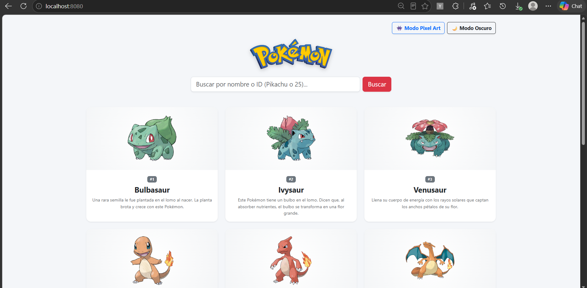
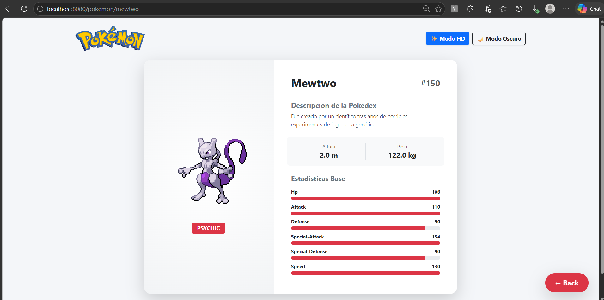

# 🔴 Pokédex Web - Spring Boot & PokéAPI

Aplicación web responsiva desarrollada en **Java con Spring Boot** y **Thymeleaf** que consume la API pública de [PokéAPI](https://pokeapi.co/) para listar, buscar y visualizar información detallada de los Pokémon.

---

## 🚀 Uso de Endpoints
## Consumo de 3 Endpoint
* `RestTemplate` (`PokeApiService`):
    * `GET /api/v2/pokemon?limit=12&offset={n}`: Obtiene el listado paginado de Pokémon para no saturar la carga inicial.
    * `GET /api/v2/pokemon/{nameOrId}`: Extrae los datos principales (ID, nombre, altura, peso, tipos, estadísticas base) junto con el arte oficial en HD y el sprite clásico en Pixel Art.
    * `GET /api/v2/pokemon-species/{id}`: Recupera la entrada oficial de la Pokédex filtrada en idioma español (`es`).

## 📸 Capturas de Pantalla

### Vista Principal (`index.html`)
Buscador, conmutadores de tema/sprites y cuadrícula responsiva de tarjetas con paginación:

### Vista de Detalle (`detalle.html`)
Estadísticas base con barras de progreso, tipos, medidas y descripción oficial:

---

## 🛠️ Tecnologías Utilizadas

* **Backend:** Java 17+, Spring Boot 3 (Spring Web), Maven
* **Frontend:** Thymeleaf, HTML5, CSS3, JavaScript (Vanilla), Bootstrap 5
* **API Externa:** PokéAPI v2
* **IDE:** IntelliJ IDEA

---